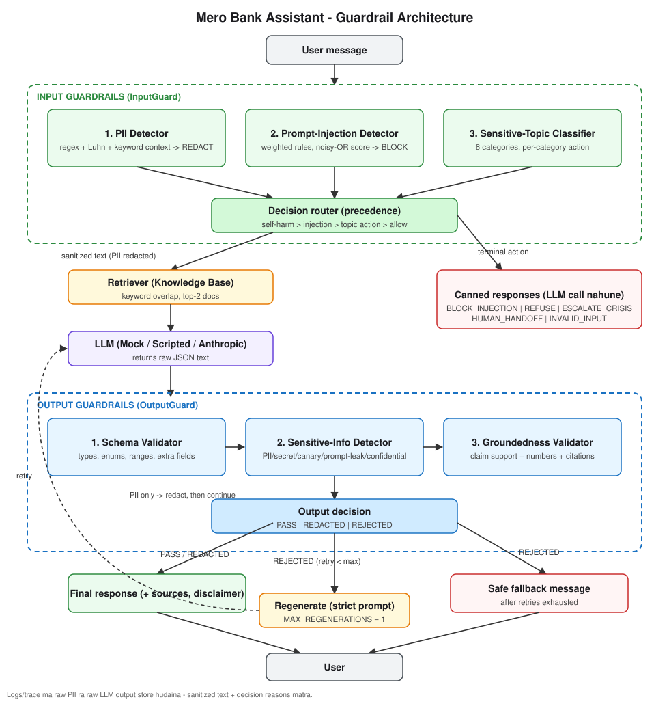
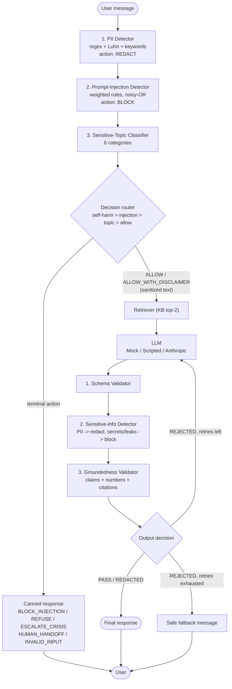

# Architecture

Same diagram as Mermaid (GitHub / VS Code Markdown preview ma render hunchha):

## Why each control sits where it does

| Stage | Control | Why here |
|---|---|---|
| Input 1 | PII redaction | Sabai bhanda pahila, taki raw PII LLM, logs, ra aaru detectors kahin pugdaina. |
| Input 2 | Prompt-injection | LLM call hunu aghi; block bhayo bhane LLM kahile call nai hudaina (cost + risk dubai kam). |
| Input 3 | Topic classifier | Kehi topic ma LLM le answer nai dinu hudaina (self-harm, illegal), kehi ma human chahincha. |
| Output 1 | Schema | Sasto, ra structure nai galat bhaye aru checks ko artha chhaina. |
| Output 2 | Sensitive info | Security-critical; groundedness bhanda aghi taki PII/secret kahile aghi nabadhos. |
| Output 3 | Groundedness | Sabai bhanda mahango, ra redacted text ma chalcha. |
| Loop | Regenerate then fallback | LLM output non-deterministic; ek palta retry garda usability badhcha, tara loop bounded chha. |

## Data flow ra privacy

- `InputDecision` ma sanitized text + PII *types* matra (raw value hoina).
- `PipelineResult.attempts` ma status + reasons matra (raw LLM output hoina).
- Test: `tests/test_guardrails.py::test_trace_has_no_raw_pii`.
